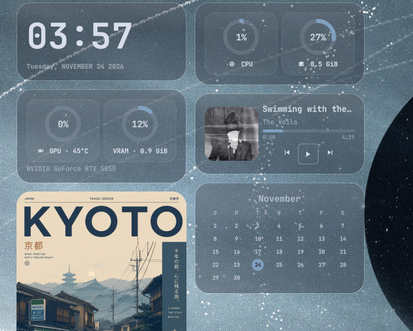
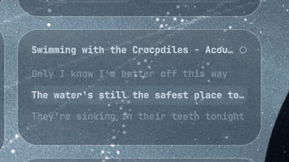
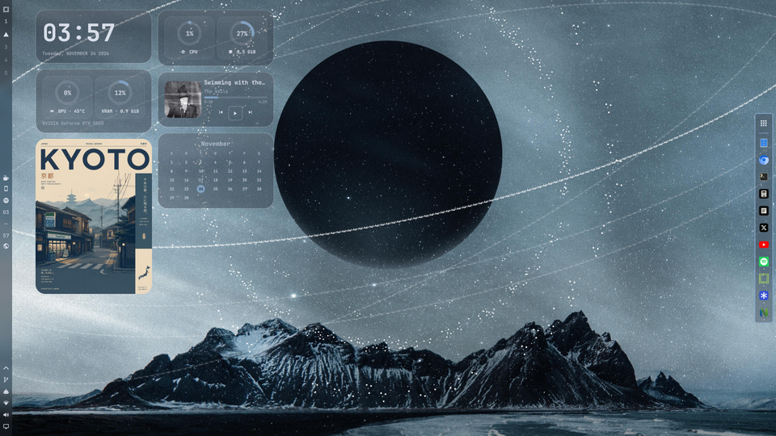

# Prism Widgets

Glass desktop widgets for Omarchy: an oversized frosted clock, CPU/RAM and
GPU ring gauges, a vinyl now-playing card with album art, a split month-grid
calendar, and a fast reminders list. Cards are theme-aware frosted glass, and
turn into real glass with the [hyprglass](https://github.com/hyprnux/hyprglass)
compositor plugin installed.





*Double-click any music, calendar, or system card to flip it over — lyrics, agenda, and per-thread detail live on the back.*



## Features

- **6 desktop cards** on the wallpaper layer (below windows, above wallpaper):
  clock, system (CPU/RAM), GPU, media, calendar, reminders
- **Switchable styles per widget** — music: Cover / Poster / Vinyl / Lyrics;
  clock: Hero / Glass / Minimal; system & GPU: Rings / Bars;
  calendar: Split / Month
- **Flippable music card** — double-click the card to flip it over:
  lyrics on the back of Cover / Poster / Vinyl, cover on the back of Lyrics
- **Flippable calendar** — double-click to flip it over: live agenda from
  your Google Calendar feeds, with refresh button
- **Flippable system card** — double-click for per-thread load detail
- **Free placement, overlap-free** — right-drag any card anywhere; a drop
  settles to the nearest spot that touches no other card, and dropping a
  card back on its stack slot rejoins the auto-flow. Drags stay clear of a
  right-edge floating dock when one is running. Pins are per-monitor, and
  stale overlaps fix themselves at startup. Reset positions & sizes
  unpins everything.
- **Photo widgets** — add your own pictures as photo tiles
- **Album art** fetched safely (bounded download, magic-byte verified)
- **Right-drag to move, corner-drag to resize** — positions persist
- **Reminders** stored locally, toggled from the desktop, added from the bar popup
- **50-language ready** display strings via `Commons.Translations`

## Requirements

- Omarchy (Quattro shell) with Quickshell
- A media player exposing [MPRIS](https://specifications.freedesktop.org/mpris-spec/latest/)
  (Spotify, Firefox, mpv, Chromium…) for the music card — no extra tools needed
- Optional: `hyprglass` for true glass refraction

## Install

```sh
omarchy plugin add https://github.com/unyxed/omarchy-prism.git --enable
```

The plugin enables itself in the bar (settings icon `◫`); desktop cards appear immediately.

## Configure

Click the `◫` bar icon for the settings popup:

- **Widgets** — toggle each card on/off
- **Widget Styles** — switch Music / Clock / System & GPU / Calendar styles
- **Glass** — install hyprglass, or tune background opacity
- **Position / Appearance** — stack corner, width, gaps, corner radius
- **Reminders** — toggle items, add new ones
- **Layout** — reset dragged positions and sizes

Right-click the bar icon to hide/show all cards at once.

Album art can be toggled? No — art shows automatically when the active player
publishes a cover URL. Players that publish none (e.g. plain YouTube tabs)
show title and controls without art.

## Remove

```sh
omarchy plugin remove unyxed.prism
```

Removal deletes the plugin directory. Your `shell.json` bar entry is cleaned up
by Omarchy; dragged positions and todos live inside that entry.

## External dependencies

None required. Optional integrations, all local:

| Integration | Used for | If missing |
|---|---|---|
| MPRIS player | Music card metadata + controls | Card shows “Nothing playing” |
| hyprglass | Glass refraction | Frosted translucent cards |
| `~/.config/omarchy/calendars.json` | Calendar feed names | Date grid still renders |

No network calls are made except cover-art downloads (bounded, verified —
see DEVELOPMENT.md). No executables ship besides the `scripts/prism-art`
fetcher helper.

## License

MIT — see [LICENSE](LICENSE).
